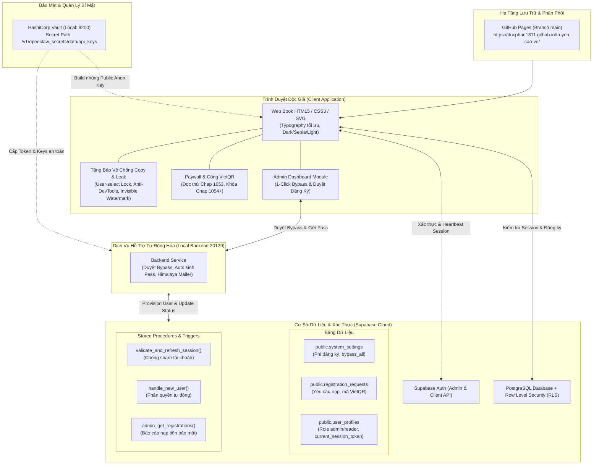

# Cao Võ: Từ Giết Gà Bắt Đầu Quét Ngang Tinh Không 🌌
> **Nền tảng Web Book đọc truyện chất lượng cao, tích hợp hệ thống xác thực Supabase, chống chia sẻ tài khoản, cổng thanh toán VietQR và hệ thống bảo vệ bản quyền đa tầng.**

[](https://ducphan1311.github.io/truyen-cao-vo/)
[](https://supabase.com)
[](http://127.0.0.1:8200)
[](https://ducphan1311.github.io/truyen-cao-vo/)

---

## 🏛️ Sơ Đồ Kiến Trúc Hệ Thống (System Architecture)



---

## 🧩 Các Cấu Phần Chính Trong Hệ Thống

### 1. Giao Diện & Trải Nghiệm Đọc (Web Book Core)
- **Nền tảng:** 100% Vanilla HTML5, CSS3 hiện đại, tối ưu tốc độ tải tức thì và hỗ trợ đọc Offline.
- **Typography văn học:** Kết hợp phông chữ `Cinzel` cổ điển cho tiêu đề tu luyện và `Merriweather` cho văn bản chương truyện, giãn dòng chuẩn 1.9 và chữ đầu đoạn (Drop-cap) nghệ thuật.
- **Chế độ đọc đa dạng:** Chuyển đổi nhanh 3 chủ đề hiển thị: **Tối (Dark)**, **Vàng cổ điển (Sepia)**, **Sáng (Light)**.
- **Thanh mục lục thông minh:** Tìm kiếm nhanh theo số chương hoặc tên chương; tự động đánh dấu chương đang đọc.

---

### 2. Hệ Thống Backend & Database (Supabase Cloud)
- **Database Engine:** PostgreSQL được quản lý trên Supabase Cloud (Project: `ujylxmkhychrcvzrlbqx`).
- **Phân quyền & Bảo mật bảng (RLS):**
  - `system_settings`: Quản lý phí kích hoạt mở khóa truyện (mặc định 100.000 VNĐ) và cờ bật/tắt `bypass_all`.
  - `registration_requests`: Ghi nhận email đăng ký, số tiền cần thanh toán, mã nội dung giao dịch riêng biệt (`CVxxxxxx`) và trạng thái kích hoạt.
  - `user_profiles`: Lưu trữ hồ sơ độc giả, vai trò (`admin` cho `ducphan1311@gmail.com`, `reader` cho người dùng thông thường), thời hạn tài khoản và token phiên làm việc hiện hành.
- **Kích hoạt Admin tự động:** Trigger `on_auth_user_created` tự động phân quyền `admin` ngay khi tài khoản quản trị được khởi tạo, không cần can thiệp thủ công vào cơ sở dữ liệu.

---

### 3. Cơ Chế Chống Chia Sẻ Tài Khoản (Single Active Session Protection) 🚫👥
- **Nguyên lý hoạt động:** Mỗi lần đăng nhập, trình duyệt của độc giả sinh ra một chuỗi định danh duy nhất (`current_session_token`) và lưu vào bảng `user_profiles`.
- **Giám sát thời gian thực:**
  - Vòng lặp kiểm tra phiên tự động chạy ngầm mỗi **15 giây** và mỗi khi độc giả bấm chuyển chương thông qua hàm RPC `validate_and_refresh_session()`.
  - **Kịch bản chống dùng chung:** Nếu độc giả chia sẻ mật khẩu cho người thứ 2 đăng nhập ở thiết bị/trình duyệt khác, `current_session_token` trong DB bị ghi đè. Máy thứ nhất sẽ ngay lập tức bị **buộc đăng xuất (force logout)** và bật cảnh báo bảo mật, ngăn chặn triệt để tình trạng mua 1 tài khoản cho cả nhóm đọc chung.

---

### 4. Hệ Thống Phòng Thủ Đa Tầng (Anti-Copy & Anti-Leak) 🛡️

| Tầng bảo vệ | Cơ chế kỹ thuật | Tác dụng |
| :--- | :--- | :--- |
| **Tầng 1: Interaction Lock** | `user-select: none !important`, `-webkit-touch-callout: none` | Cấm bôi đen văn bản trên toàn bộ giao diện (cả PC và điện thoại cảm ứng). |
| **Tầng 2: Shortcut & Context Lock** | Bắt sự kiện phím và chuột ở pha capture | Vô hiệu hóa chuột phải; chặn `Ctrl/Cmd + C, A, X, S, P, U` (sao chép, lưu trang, xem mã nguồn). |
| **Tầng 3: Print Disabler** | CSS `@media print { body { display: none !important; } }` | Nếu độc giả dùng lệnh in của trình duyệt để lưu thành PDF, toàn bộ trang in sẽ biến thành trang trắng. |
| **Tầng 4: Anti-DevTools Trap** | Chặn F12, Ctrl+Shift+I/J/C + Vòng lặp `debugger` tự kích hoạt liên tục | Khi kẻ xấu cố tình mở F12 / Inspect Element, trình duyệt sẽ bị khựng lại ngay lập tức tại điểm dừng debugger, không thể soi thẻ chứa nội dung. |
| **Tầng 5: Poison Clipboard** | Ghi đè sự kiện `copy` | Nếu cố tình copy qua bất kỳ công cụ nào, nội dung sao chép sẽ bị tráo thành thông báo bản quyền thay vì nội dung truyện. |
| **Tầng 6: Invisible Watermark ⭐** | Kỹ thuật giấu tin (Zero-Width Steganography) | Nhúng mã nhị phân địa chỉ Email của chính tài khoản đang đọc vào giữa các từ bằng ký tự vô hình (`\u200B`, `\u200C`, `\u200D`). Mắt người nhìn bình thường, nhưng nếu truyện bị copy/leak ra ngoài, chỉ cần kiểm tra text là **truy vết chính xác 100% email kẻ tuồn truyện** để khóa tài khoản vĩnh viễn. |

---

### 5. Cổng Thanh Toán Tự Động (VietQR) & Paywall Đọc Thử
- **Đọc thử miễn phí:** Khách vãng lai được mở đọc thử trọn vẹn Chương 1053.
- **Paywall tự động:** Khi người dùng chuyển sang Chương 1054 trở đi mà chưa đăng nhập, nội dung chương truyện sẽ được ẩn hoàn toàn và thay thế bằng khung thông báo đăng ký đọc truyện.
- **Tích hợp VietQR:** Khi độc giả nhập email đăng ký, hệ thống tự động sinh mã QR chuyển khoản ngân hàng chuẩn Napas VietQR kèm số tiền (100.000 VNĐ) và cú pháp nội dung chuyển khoản riêng biệt.

---

### 6. Bảng Quản Trị Hệ Thống (Admin Dashboard)
- Dành riêng cho tài khoản Quản trị viên (`ducphan1311@gmail.com`).
- Tích hợp nút **⚙️ Quản Trị** ngay trên thanh công cụ sau khi đăng nhập.
- **Chức năng chính:**
  - Theo dõi danh sách tất cả các yêu cầu đăng ký đọc truyện, số tiền và mã chuyển khoản theo thời gian thực.
  - Phân loại rõ ràng các trạng thái: *Chưa Nạp*, *Đã Nạp*, *Đã Bypass*.
  - Tính năng **[Bypass & Gửi Pass]** 1-Click: Tự động sinh mật khẩu ngẫu nhiên an toàn, tạo tài khoản trong hệ thống xác thực Supabase Auth và tự động gửi email thông tin đăng nhập trực tiếp về hòm thư của độc giả.

---

## 🔒 Quản Lý Bí Mật & Thông Tin Đăng Nhập (Vault)

- Tất cả các API Token và Khóa dịch vụ (`SUPABASE_ACCESS_TOKEN`, `SERVICE_ROLE_KEY`, `VAULT_TOKEN`) được lưu trữ tập trung và an toàn tuyệt đối bên trong **HashiCorp Vault**:
  - **Vault Endpoint:** `http://127.0.0.1:8200`
  - **Secret Path:** `/v1/openclaw_secrets/data/api_keys`
- Mã nguồn công khai đẩy lên GitHub chỉ chứa khóa công khai (`ANON_PUBLIC_KEY`), tuân thủ 100% tiêu chuẩn bảo mật dữ liệu hiện đại.

---

## 🚀 Hướng Dẫn Vận Hành & Sử Dụng

### Khởi động dịch vụ hỗ trợ Admin cục bộ (nếu cần xử lý gửi email và bypass tự động):
```bash
node /Users/ducphan/truyen-cao-vo/backend_service.js
```

### Build lại giao diện Web khi cập nhật chương mới:
```bash
node /Users/ducphan/truyen-cao-vo/build_secure_web.js
git add .
git commit -m "Update novel chapters"
git push origin main
```

### Truy cập web đọc truyện:
👉 **[https://ducphan1311.github.io/truyen-cao-vo/](https://ducphan1311.github.io/truyen-cao-vo/)**
