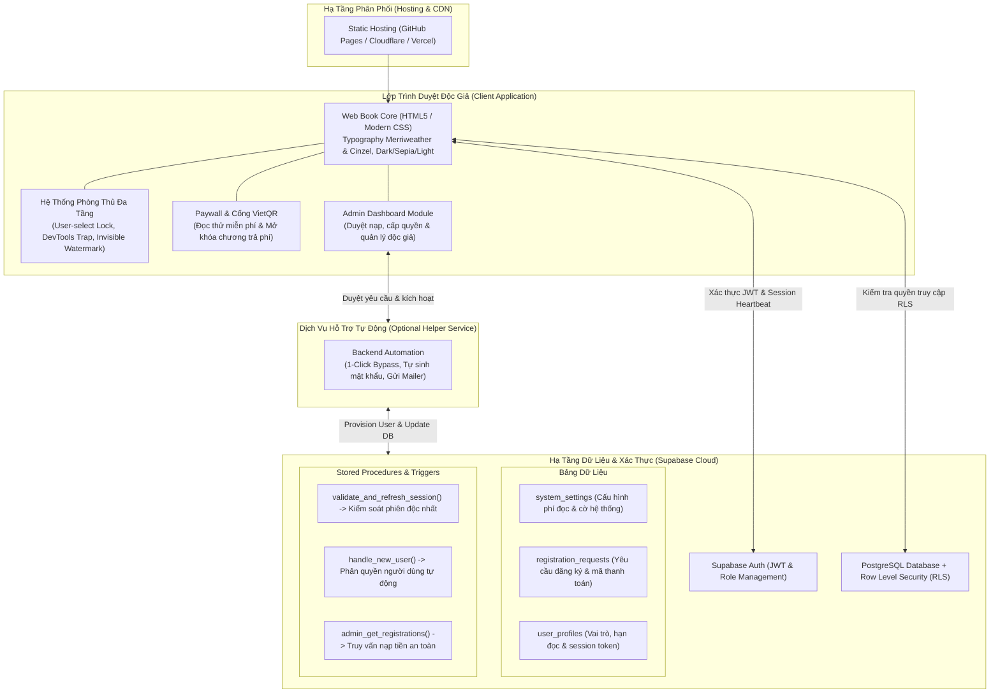

# WebNovel Secure Reader Engine 🌌
> **Nền tảng Web Book đọc truyện mã nguồn mở với trải nghiệm đọc chuẩn văn học, tích hợp xác thực đám mây (Supabase), chống chia sẻ tài khoản (Single Active Session), cổng thanh toán VietQR và hệ thống bảo vệ bản quyền đa tầng.**

[](https://opensource.org/licenses/MIT)
[](https://pages.github.com/)
[](https://supabase.com)
[](https://github.com)
[](https://github.com)

---

## 📖 Giới Thiệu (Overview)

**WebNovel Secure Reader Engine** là giải pháp xuất bản và số hóa truyện chữ/tiểu thuyết trực tuyến dạng **Web Book một trang (Single-Page Web Book)** độc lập, có thể lưu trữ và triển khai hoàn toàn miễn phí qua **GitHub Pages, Vercel hoặc Cloudflare Pages**.

Dự án được thiết kế chuyên biệt để giải quyết các bài toán lớn của các dịch giả và tác giả truyện trực tuyến:
- **Tối ưu trải nghiệm đọc:** Giao diện chuẩn typography văn học cổ điển, tối ưu mắt đọc, đọc offline mượt mà.
- **Bảo vệ bản quyền (Anti-Piracy / DRM):** Ngăn chặn người dùng bôi đen, copy, chuột phải, cào text bằng DevTools hoặc chụp ảnh trích xuất.
- **Chống mua chung / chia sẻ tài khoản:** Mỗi tài khoản chỉ được phép hoạt động trên một thiết bị duy nhất tại một thời điểm (Single Active Session).
- **Hệ thống Paywall & Quản lý nạp tự động:** Tự động hiển thị mã chuyển khoản VietQR Napas động và cung cấp giao diện quản trị (Admin Dashboard) phê duyệt nhanh chóng.

---

## 🏛️ Sơ Đồ Kiến Trúc Hệ Thống (Architecture)



---

## ✨ Tính Năng Nổi Bật (Key Features)

### 1. Trải Nghiệm Đọc Tiêu Chuẩn Văn Học
- **Typography & Font nghệ thuật:** Sử dụng phông chữ serif `Merriweather` cho văn bản chính và `Cinzel` cho tiêu đề chương, tỉ lệ co giãn dòng 1.9 tối ưu cho mắt.
- **3 Chế độ màu:** Hỗ trợ nhanh chế độ **Ban Đêm (Dark)**, **Giấy Cũ (Sepia)** và **Ban Ngày (Light)**.
- **Mục lục thông minh:** Tìm kiếm nhanh chương truyện theo từ khóa hoặc số thứ tự, ghi nhớ vị trí chương đang đọc.

### 2. Cơ Chế Chống Chia Sẻ Tài Khoản (Single Active Session)
- **Token phiên độc nhất:** Mỗi khi đăng nhập, hệ thống cấp một `session_token` ngẫu nhiên và lưu vào cơ sở dữ liệu.
- **Đá văng phiên cũ (Force Logout):** Kiểm tra phiên thời gian thực mỗi 15 giây. Nếu tài khoản được đăng nhập ở thiết bị thứ 2, thiết bị cũ sẽ lập tức bị buộc đăng xuất kèm cảnh báo bảo mật, ngăn chặn hành vi mua chung tài khoản.

### 3. Hệ Thống Phòng Thủ Đa Tầng Chống Trích Xuất (Anti-Scraping DRM)

| Cơ Chế | Phương Thức | Tác Dụng Phòng Thủ |
| :--- | :--- | :--- |
| **User Interaction Lock** | `user-select: none !important`, `-webkit-touch-callout: none` | Khóa bôi đen văn bản trên cả PC lẫn màn hình cảm ứng di động. |
| **Shortcut & Context Blocker** | Lắng nghe sự kiện bàn phím/chuột ở pha Capture | Vô hiệu hóa chuột phải; chặn các tổ hợp `Ctrl/Cmd + C, A, X, S, P, U`. |
| **Print Neutralizer** | CSS `@media print { body { display: none !important; } }` | Vô hiệu hóa tính năng in của trình duyệt; xuất ra trang trắng khi cố lưu PDF. |
| **Anti-DevTools Trap** | Chặn `F12`, `Ctrl+Shift+I` & Vòng lặp `debugger` tự động | Làm khựng trình duyệt nếu cố tình mở DevTools/Inspect Element để soi mã HTML. |
| **Clipboard Poisoning** | Ghi đè sự kiện `copy` | Tráo đổi nội dung copy thành thông báo bản quyền nếu kẻ xấu cố tình bypass. |
| **Invisible Watermark ⭐** | Kỹ thuật giấu tin (Zero-Width Steganography) | Nhúng mã nhị phân địa chỉ email của độc giả vào giữa các đoạn văn bằng ký tự vô hình (`\u200B`, `\u200C`, `\u200D`). Mắt người nhìn bình thường, nhưng nếu truyện bị copy/chụp leak ra ngoài, tác giả có thể **giải mã văn bản để truy vết chính xác tài khoản đã phát tán** và khóa vĩnh viễn. |

### 4. Paywall Linh Hoạt & Cổng VietQR
- Cho phép cấu hình số chương đọc thử miễn phí cho khách vãng lai.
- Tự động kích hoạt khung Paywall khi đọc đến các chương trả phí.
- Tích hợp chuẩn VietQR Napas động: Tự động tính toán số tiền và sinh mã chuyển khoản riêng cho từng giao dịch.

### 5. Bảng Điều Khiển Quản Trị (Admin Dashboard)
- Tích hợp trực tiếp trên giao diện khi đăng nhập bằng tài khoản có vai trò `admin`.
- Xem danh sách độc giả chờ kích hoạt, mã giao dịch và số tiền.
- Tính năng **1-Click Bypass**: Tự động sinh mật khẩu bảo mật ngẫu nhiên, kích hoạt người dùng và gửi thông tin về email của độc giả.

---

## 🚀 Hướng Dẫn Cài Đặt & Triển Khai (Quickstart)

### Yêu Cầu Môi Trường
- [Node.js](https://nodejs.org/) (phiên bản 18+ hoặc 20+)
- Tài khoản [Supabase](https://supabase.com) (gói miễn phí)
- Kho lưu trữ GitHub hỗ trợ GitHub Pages

---

### Bước 1: Khởi Tạo Cơ Sở Dữ Liệu Supabase

1. Tạo một dự án mới trên [Supabase Console](https://supabase.com/dashboard).
2. Mở tab **SQL Editor**, chạy đoạn script khởi tạo schema, phân quyền RLS và triggers:

```sql
-- 1. Bảng cấu hình hệ thống
CREATE TABLE IF NOT EXISTS public.system_settings (
  id UUID PRIMARY KEY DEFAULT gen_random_uuid(),
  key TEXT UNIQUE NOT NULL,
  value JSONB NOT NULL,
  updated_at TIMESTAMPTZ DEFAULT now()
);

-- 2. Bảng yêu cầu đăng ký & nạp tiền
CREATE TABLE IF NOT EXISTS public.registration_requests (
  id UUID PRIMARY KEY DEFAULT gen_random_uuid(),
  email TEXT UNIQUE NOT NULL,
  amount_expected NUMERIC NOT NULL,
  payment_code TEXT NOT NULL,
  status TEXT DEFAULT 'pending_payment',
  generated_password TEXT,
  created_at TIMESTAMPTZ DEFAULT now(),
  updated_at TIMESTAMPTZ DEFAULT now()
);

-- 3. Bảng hồ sơ độc giả & phiên làm việc
CREATE TABLE IF NOT EXISTS public.user_profiles (
  id UUID PRIMARY KEY REFERENCES auth.users(id) ON DELETE CASCADE,
  email TEXT UNIQUE NOT NULL,
  role TEXT DEFAULT 'reader',
  active_until TIMESTAMPTZ,
  current_session_token TEXT,
  last_heartbeat TIMESTAMPTZ DEFAULT now(),
  created_at TIMESTAMPTZ DEFAULT now()
);

-- 4. Kích hoạt Row Level Security (RLS)
ALTER TABLE public.system_settings ENABLE ROW LEVEL SECURITY;
ALTER TABLE public.registration_requests ENABLE ROW LEVEL SECURITY;
ALTER TABLE public.user_profiles ENABLE ROW LEVEL SECURITY;
```

---

### Bước 2: Cấu Hình Biến Môi Trường

Tạo file cấu hình môi trường hoặc thiết lập biến trong môi trường triển khai của bạn:

```env
SUPABASE_URL=https://your-project.supabase.co
SUPABASE_ANON_KEY=your-anon-public-key
SUPABASE_SERVICE_ROLE_KEY=your-service-role-key
ADMIN_EMAIL=admin@yourdomain.com
```

---

### Bước 3: Đóng Gói Dữ Liệu Chương & Triển Khai

1. Đưa nội dung các chương truyện đã biên soạn vào file dữ liệu `chapters.json`:
   ```json
   [
     {
       "num": 1,
       "title": "Tên Chương Mở Đầu",
       "content": "Nội dung chương văn bản thuần...\n\nĐoạn tiếp theo..."
     }
   ]
   ```
2. Chạy kịch bản đóng gói để sinh mã nguồn `index.html`:
   ```bash
   node build_secure_web.js
   ```
3. Đẩy mã nguồn lên nhánh `main` của GitHub Repository để tự động kích hoạt **GitHub Pages**:
   ```bash
   git add .
   git commit -m "Deploy Web Book"
   git push origin main
   ```

---

## 🛡️ Khuyến Cáo Bản Quyền & Bảo Mật

- **Khóa bí mật:** Không bao giờ đưa `SERVICE_ROLE_KEY` lên mã nguồn công khai hoặc giao diện phía client. Chỉ sử dụng `ANON_PUBLIC_KEY` cho trình duyệt.
- **Thủy ấn truy vết:** Hãy bảo mật cơ chế mã hóa thủy ấn vô hình để tránh kẻ gian phân tích loại bỏ các ký tự điều khiển zero-width trước khi leak.
- **Bản quyền tác phẩm:** Người vận hành chịu trách nhiệm về tính pháp lý và bản quyền của các nội dung tác phẩm văn học được xuất bản trên nền tảng.

---

## 🤝 Đóng Góp Phát Triển (Contributing)

Mọi đóng góp nhằm tối ưu hóa hiệu năng, cải tiến giao diện đọc và tăng cường các lớp bảo mật bản quyền đều được hoan nghênh.
1. Fork dự án
2. Tạo nhánh tính năng (`git checkout -b feature/AmazingFeature`)
3. Commit thay đổi (`git commit -m 'Add some AmazingFeature'`)
4. Push lên nhánh (`git push origin feature/AmazingFeature`)
5. Mở một Pull Request

---

## 📄 Giấy Phép (License)

Dự án được phân phối dưới giấy phép **MIT License**. Xem chi tiết tại tệp `LICENSE`.
